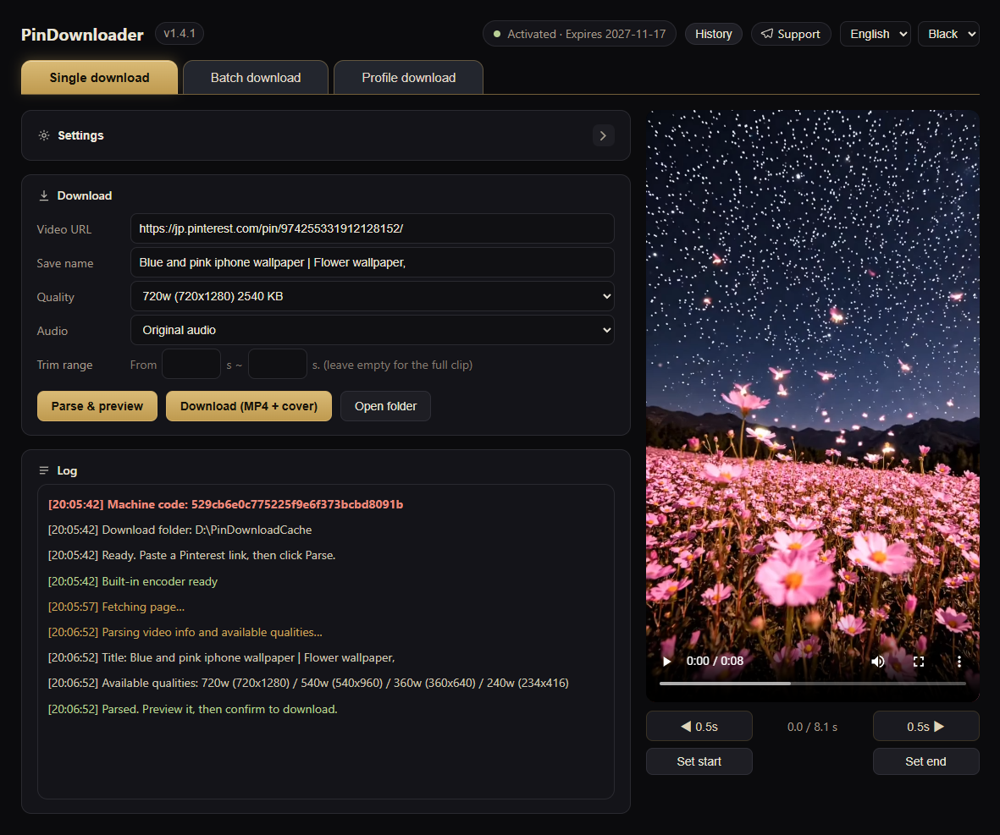
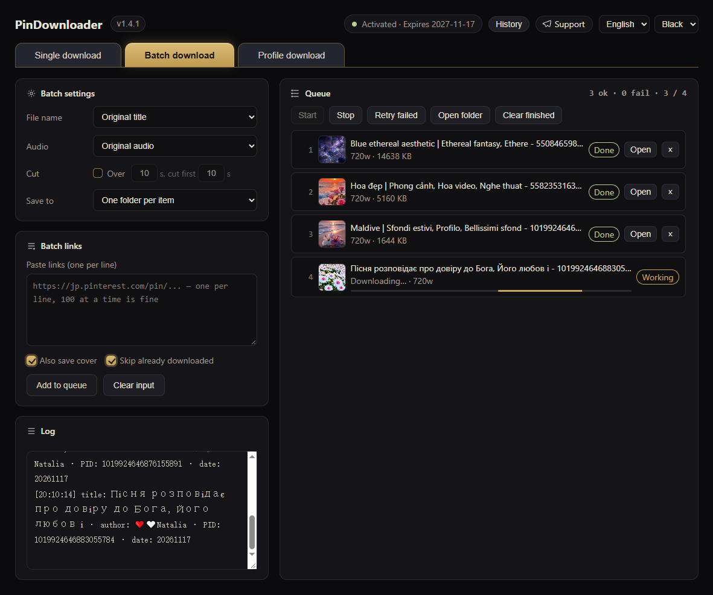
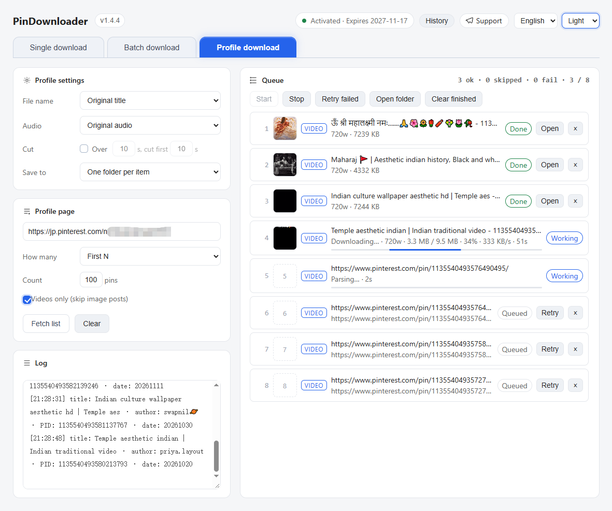

# PinDownloader

**Pinterest video downloader for Windows 10 / 11** — download one Pin, a batch of up to 100 links, or every video on a whole profile, and save them as clean MP4 files with their cover images.

Official website: **https://pin.wangpanmao.com/**

> This repository is the public download / documentation page for the product. It does **not** contain source code. See [LICENSE](LICENSE) — the software is proprietary, all rights reserved.

---

## Download

| Where | Link |
|---|---|
| **GitHub Releases (recommended)** | [Download `PinDownloader_1.4.6.exe`](releases/latest) |
| Google Drive | link in the release notes |
| MEGA | link in the release notes |
| Website mirrors | https://pin.wangpanmao.com/#download |

- Windows 10 / 11, 64-bit · single 90.6 MB exe · no installer, no background service
- Version **1.4.6** · SHA-256 `910816C6CAD0F60979CC7A624034266D2A30DE70DC38541C5AD836583F6054D3`
- Unsigned build, so SmartScreen shows the usual “unknown publisher” prompt: **More info → Run anyway**

## What it does

Three modes live in the same window, each with its own queue and its own log.

| Mode | Input | What you get |
|---|---|---|
| **Single Pin** | one Pin URL | every quality Pinterest serves (720w / 540w / 360w / 240w), inline preview, optional trim range |
| **Batch** | up to 100 links, one per line | an ordered queue with cover thumbnails and live progress per row (bytes, %, speed, elapsed time) |
| **Profile** | a profile URL | first N pins or a range such as No.5 – No.24, with **Videos only** on by default so image Pins never reach the queue |

Other things that matter:

- Real MP4 output — progressive when Pinterest exposes it, otherwise the bundled encoder muxes the HLS stream locally
- Cover image saved next to the video, named to match
- No watermark, no Pinterest login, no browser extension
- History stores the real saved path; “already downloaded” only counts while the file still exists
- Hard timeouts on parsing and downloading, so a dead connection fails with a reason instead of hanging
- Default folder `D:\PinDownloadCache` (falls back to `C:\PinDownloadCache`), created automatically
- English / 中文 UI, Black / Light skin, both remembered

## Screenshots

**Single Pin**

**Batch download**

**Profile download**

## Install

1. Download `PinDownloader_1.4.6.exe` from [Releases](releases/latest).
2. Double-click it. If Windows shows “Windows protected your PC”, choose **More info → Run anyway**.
3. The app opens on the Single download tab. Paste a Pin link, press **Parse & preview**, pick a quality, press **Download**.

Full instructions: [`使用说明.txt`](使用说明.txt) (Chinese) · [`Quick-Guide.txt`](Quick-Guide.txt) (English)

## Licensing

The app is paid software with a fixed price per plan (monthly / yearly / lifetime, paid once through PayPal). After payment the machine code shown in the app is sent to the seller, who returns a licence code. One code works on one PC; moving to a new machine needs the seller to unbind it.

Plans and payment: https://pin.wangpanmao.com/#pricing

## Requirements

- Windows 10 or Windows 11, 64-bit
- ~250 MB free disk space (the bundled encoder is released on first run)
- Internet access to Pinterest

## Changelog

### 1.4.6
- Window is now truly fixed: maximize removed, resize borders removed, client area locked at 1181×987
- Window matching hardened: identifies its own top-level WinForms window by process + window class + caption, so a same-named folder or browser tab can never be picked
- Docs reorganised: features and usage first, purchase/activation last

### 1.4.4
- Batch and Profile modes skip image Pins at fetch time instead of reporting failures
- Profile log summarises totals: pins, videos, non-video ignored

## Contact

- Website: https://pin.wangpanmao.com/
- Telegram: [@leoli2027](https://t.me/leoli2027)
- Email: sharks1039@gmail.com

---

PinDownloader is an independent tool and is not affiliated with, endorsed by, or sponsored by Pinterest, Inc. “Pinterest” is a trademark of Pinterest, Inc. Download only content you own or have permission to use, and respect Pinterest’s Terms of Service.
